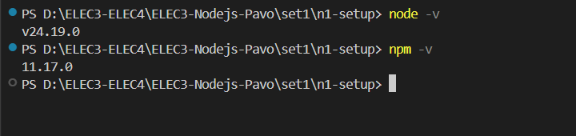
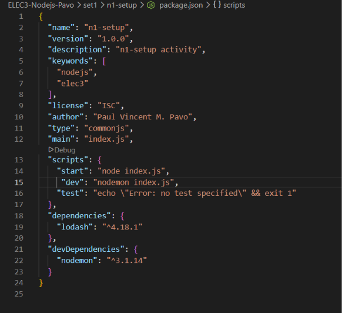
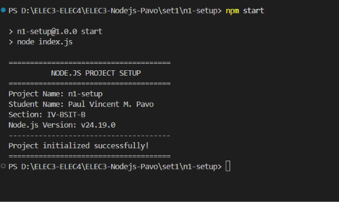
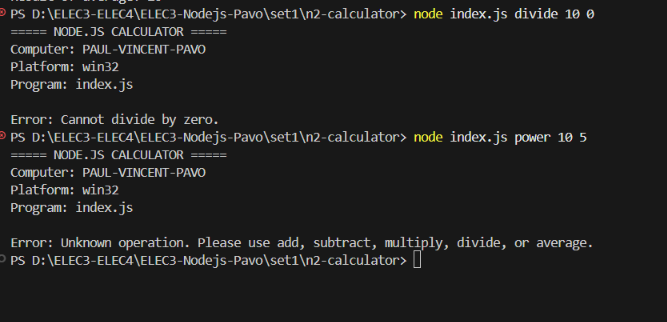
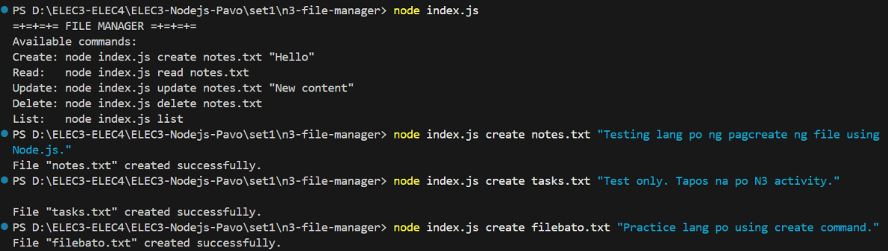
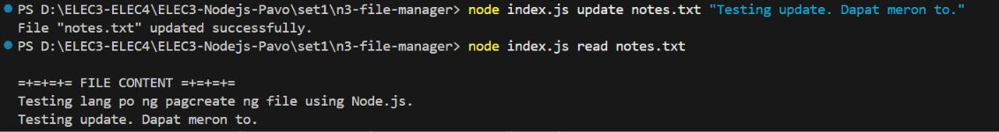
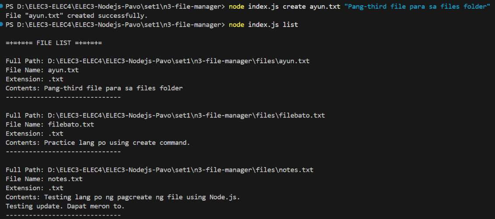

# ELEC3 – Node.js Self-Paced Assignments

**Name:** Paul Vincent M. Pavo  
**Section:** IV-BSIT-B  
**Subject:** ELEC3 – Node.js  

---

## About This Repository

This repository contains my outputs for the ELEC3 Node.js Self-Paced Assignment. It includes activities and exercises that shows my understanding of Node.js fundamentals, modules, command-line arguments, and file system operations.

Each activity is organized into its own folder, with its source code and screenshots of the program outputs.

## Activities

| Activity | Description | Folder |
|---|---|---|
| N1 – Node.js Project Setup and Package Management | Initializes a Node.js project and displays project information, including the Node.js version. | [n1-setup](set1/n1-setup/) |
| N2 – Modular Calculator | Performs basic arithmetic operations and calculates the average using command-line arguments and separate modules. | [n2-calculator](set1/n2-calculator/) |
| N3 – File Manager with fs and path | Performs file creation, reading, updating, deletion, and listing using Node.js `fs` and `path` modules. | [n3-file-manager](set1/n3-file-manager/) |

---

## Set 1 Activities

### N1 – Node.js Project Setup

This activity demonstrates the initialization of a Node.js project, including the use of `package.json`, npm scripts, and Node.js information.

**Run the program:**

```bash
cd set1/n1-setup
npm install
npm start
```

**Screenshots:**

**Node.js and npm Versions**



**Package Configuration**



**NPM Start Output**



---

### N2 – Command-Line Calculator

This activity demonstrates the use of command-line arguments, built-in Node.js modules, and custom modules. The calculator supports addition, subtraction, multiplication, division, and average calculations. It also handles invalid inputs and division by zero.

**Run the program:**

```bash
cd set1/n2-calculator
node index.js add 10 5
```

**Other examples:**

```bash
node index.js subtract 10 5
node index.js multiply 10 5
node index.js divide 10 5
node index.js average 10 20 30
```

**Screenshots:**

**Calculator Results**


**Error Handling**



---

### N3 – File Manager

This activity demonstrates file system operations using the built-in `fs` and `path` modules. The program allows users to create, read, update, delete, and list text files through command-line commands.

**Run the program:**

```bash
cd set1/n3-file-manager
```

**Available commands:**

Create a file:

```bash
node index.js create notes.txt "Hello World"
```

Read a file:

```bash
node index.js read notes.txt
```

Update a file:

```bash
node index.js update notes.txt "Additional content"
```

Delete a file:

```bash
node index.js delete notes.txt
```

List files:

```bash
node index.js list
```

**Screenshots:**

**Create File**



**Read File**


**Update File**



**Delete File**


**List Files**



---

## Repository Structure

```text
ELEC3-Nodejs-Pavo/
│
├── .gitignore
├── README.md
│
└── set1/
    │
    ├── n1-setup/
    │   ├── index.js
    │   ├── package.json
    │   ├── package-lock.json
    │   ├── N1_answers.docx
    │   └── screenshots/
    │       ├── npm-start.png
    │       ├── package-json.png
    │       └── versions.png
    │
    ├── n2-calculator/
    │   ├── index.js
    │   ├── operations.js
    │   ├── formatter.js
    │   └── screenshots/
    │       ├── Result of operations.png
    │       └── error-cases.png
    │
    └── n3-file-manager/
        ├── index.js
        ├── files/
        └── screenshots/
            ├── create-file.png
            ├── delete-file(with-msg-for-not-existing) ayun anhaba.png
            ├── list-file.png
            ├── read-file(with-msg-for-non-existing-file).png
            └── update-file.png
```

---

## Technologies and Modules Used

- **Node.js** – JavaScript runtime environment.
- **npm** – Node.js package manager.
- **fs** – Built-in module for file system operations.
- **path** – Built-in module for handling file and directory paths.
- **os** – Built-in module for retrieving operating system information.
- **CommonJS Modules** – Used to organize and import JavaScript code.

---

## GitHub Repository

**Repository Link:**  
[ELEC3-Nodejs-Pavo](https://github.com/paulvincent-p/ELEC3-Nodejs-Pavo)

**Branches:**
- `main` – Main branch that contains the completed and merged assignment sets.
- `set-1` – Branch that contains the Set 1 activities.

